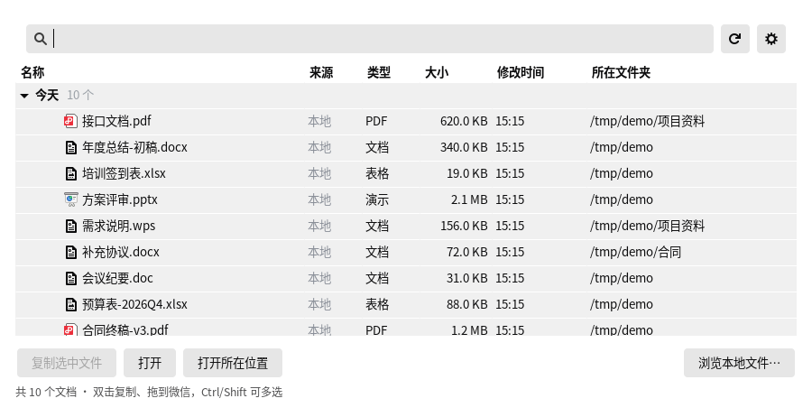

<div align="center">


# WPS 最近文档

在银河麒麟、深度等 Linux 桌面上，把 WPS 里的文档**一步放进剪贴板**，
到桌面、微信、邮件客户端直接 `Ctrl+V`。

[](https://github.com/mzjw159/wps-clip-bridge/releases/latest)
[](https://github.com/mzjw159/wps-clip-bridge/actions/workflows/ci.yml)
[](LICENSE)
[](#兼容性)
[](#开发)

[功能](#功能) · [安装](#安装) · [使用](#使用) · [配置](#配置) · [常见问题](#常见问题) · [开发](#开发)

</div>



## 为什么需要它

在 Windows 上，WPS 文档列表里右键「复制」，去桌面或微信按 `Ctrl+V`，文件就过去了。
在 Linux 上，同一个按钮点下去，到哪儿粘贴都是灰的。

这不是配置问题，是那个按钮在 WPS for Linux 里**没有实现**：它只声明剪贴板的
所有权，一个字节的文件数据都没写进去，也没有藏到别处 —— 数据从未离开 WPS 进程，
外部做格式转换、做中转都无从下手。

所以本工具**绕开那个按钮**：直接读 WPS 自己的最近文档记录，把文件作为真正的文件
对象（`text/uri-list`）放进剪贴板。详细取证过程见 [docs/DESIGN.md](docs/DESIGN.md)。

## 功能

- **三种入口**：全局热键、图形窗口、命令行，按习惯挑一个
- **多选与拖拽**：`Ctrl` / `Shift` 多选后一次复制，也可以直接把行拖到微信窗口
- **一个常驻服务**持剪贴板：窗口关了、关了应用，剪贴板里的文件还在
- **按时间分组**（今天 / 昨天 / 近 3 天 …），带搜索、类型识别、文件大小
- **搜索高亮 + 分词**：命中的字加底色；空格分开的多个词要同时命中
- **类型/来源筛选**（可叠加）**会记住**，下次打开还是那个视角，一键 `×` 还原
- **点表头排序**：名称 / 来源 / 类型 / 大小 / 时间 / 文件夹，升序降序三态切换
- **置顶**：常用的那几个钉在列表最上方，不会被新文件挤下去
- **列宽会记住**：拖过表头分隔条，下次打开还是你调好的样子
- **超量提示**：文档太多时只画前 200 条，状态栏明说还有多少更早的没列出，
  搜索照样覆盖全部
- **键盘全流程**：`↑↓` 选、`Enter` 复制、`Ctrl+A` 全选、`Ctrl+C` 复制、
  `Ctrl+F` 回到搜索框、`Esc` 清空搜索、`Delete` 移入回收站
  —— 热键唤起后手不用离开键盘
- **托盘菜单直接列最近 5 个**：右键托盘图标就能复制刚才那个文件，不必先开窗口
- **Wayland 兜底**：装了 `wl-clipboard` 时额外写一份到原生 Wayland 剪贴板，
  纯 Wayland 应用（GTK4 / Qt6）也粘得出来
- **设置可调**：换热键、主题（跟随系统/浅色/深色）、列表条数、关闭收托盘、
  复制后自动收起、开机自启
- **托盘图标自绘**：单击唤回窗口，最小化到任务栏后也点得出来
- **零额外依赖**：`python-xlib` 已打进包里，双击安装、离线 `dpkg -i` 都能用

## 安装

### 加 apt 源（装一次，以后能 `apt upgrade`）

```sh
echo "deb [trusted=yes] https://mzjw159.github.io/wps-clip-bridge/apt stable main" \
  | sudo tee /etc/apt/sources.list.d/wps-clip-bridge.list
sudo apt update
sudo apt install wps-clip-bridge
```

以后有新版本直接 `sudo apt upgrade`，不用再回来下载。

> 这个是自建源、**没有 GPG 签名**，所以那一行必须带 `[trusted=yes]` —— 意思是
> 你明确信任这一个源。介意的话用下面的方式手动装。

### 从 Release 下载（不想加源时）

到 [Releases](https://github.com/mzjw159/wps-clip-bridge/releases/latest) 下载
`wps-clip-bridge_x.y.z_all.deb` 和 `SHA256SUMS`，任选一种装法：

```sh
sudo apt install ./wps-clip-bridge_*_all.deb   # 推荐，会自动补依赖
```

- 双击 `.deb`，用系统安装器（麒麟上是「安装器 / kylin-installer」）；
- 离线时 `sudo dpkg -i wps-clip-bridge_*_all.deb`。

校验下载：

```sh
sha256sum -c SHA256SUMS
```

装完**不用重启**，启动一次即可（之后开机会自动运行）：

```sh
wps-copy --start
```

> **装过手工部署的旧版本？** 先跑一次 `wps-copy --migrate`，清掉旧的自启项和
> 残留进程，避免两套程序抢剪贴板和热键。

### 从源码构建

```sh
git clone https://github.com/mzjw159/wps-clip-bridge.git
cd wps-clip-bridge
./build.sh                 # 产出 dist/wps-clip-bridge_<版本>_all.deb
sudo apt install ./dist/wps-clip-bridge_*_all.deb
```

只需要 `dpkg-deb` 和 `gzip`，不需要 `debhelper` / `fakeroot`。

### 卸载

```sh
sudo apt remove wps-clip-bridge
```

配置和日志不会自动删，要彻底清理再删这两个目录：

```sh
rm -rf ~/.config/wps-clip-bridge ~/.local/state/wps-clip-bridge
```

## 使用

### 1. 全局热键（最快）

按 `Ctrl+Alt+C` → 弹出最近文档列表 → **双击**要的那一行 → 切到目标程序按 `Ctrl+V`。

窗口在后台时再按一次热键，会把已有窗口提到前面，不会重复开窗口。

`Ctrl+Shift+C` 更省事：**不弹窗**，直接把最近一个文档放进剪贴板，适合「就复制刚才
那个」。复制完会弹一条桌面通知告诉你复制的是哪个文件。

> `Ctrl+Shift+C` 在终端、VS Code 里常被用作「复制」，全局热键会优先截获它。介意
> 的话在设置里换成 `Ctrl+Shift+Alt+C` 之类，两组键都能改。

### 2. 图形窗口

应用菜单 →「WPS 最近文档」，或：

```sh
wps-copy --gui
```

窗口里有搜索、类型/来源两个筛选下拉、刷新、**「浏览本地文件…」**（支持多选，
选列表里没有的文件）。

**搜索会高亮**：命中的字加黄底，命中在文件夹名上时「所在文件夹」那一列也会标出来
—— 只把行留下、让人自己找是哪几个字，等于没筛。

**多个词用空格分开**，每个词都要命中（`季度 报告` = 名字或目录里既有「季度」又有
「报告」）。词序随意，中文输入法打出来的全角空格也认。

**筛选**：`全部类型` / `全部来源` 两个下拉，各自可以选一类，也可以叠加
（`表格` + `微信` 就是微信来的表格）。筛选只影响「看」，托盘菜单的最近 5 个和
`wps-copy <序号>` 仍然是完整的清单。**选择会被记住**，下次打开还是这个视角；
右边出现的 `×` 一下就能回到全部（状态栏也会写明当前在筛什么，不至于以为文件丢了）。

**列宽可以拖，拖完会记住**：表头之间的分隔条拖一下，下次打开还是这个宽度。
最后一列（所在文件夹）不记 —— 它是自动吃掉剩余宽度的那一列，记住了反而会把
窗口大小写死。想回到默认，把分隔条双击一下（GTK 的自动适应）或删掉配置里的
`col_widths`。

**文档很多时只画前 200 条**：状态栏会写「另有 N 个更早的未列出」，把鼠标停在
状态栏上能看到完整解释。搜索和筛选跑在**全部**文档上，不受这个上限影响 ——
所以找早期的文件直接搜名字就行，不用翻页。

**点表头排序**：名称 / 来源 / 类型 / 大小 / 最近打开 / 所在文件夹都能点。
点一下升序、再点降序、第三下回到默认的按时间分组，方向会标在表头上（`大小 ↓`）。
手动排序时不按天分组 —— 两套顺序会打架。大小按真实字节数比，`1.0 MB` 与
`980 KB` 不会排反。排序不记忆：关掉再打开还是按时间分组。

**不用鼠标也能操作**：热键唤起后焦点在搜索框，直接打字过滤；按 `↓` 落到列表
第一项，`↑↓` 走动，`Enter` 复制（等价于双击）。搜索框里直接按 `Enter` 就是
「复制第一条结果」——「搜完就粘」不用换手。

| 按键 | 作用 |
|---|---|
| `↑` `↓` | 在列表里移动（没选中时会自动选上第一/最后一项） |
| `Enter` | 复制选中的文件（搜索框里按也行） |
| `Ctrl` + `F` | 回到搜索框（连按会把已有内容选中，直接改写） |
| `Ctrl` + `A` / `C` | 全选 / 复制 |
| `Delete` | 移到回收站（会二次确认） |
| `Esc` | 搜索框里有字时先清空，再按一次收进托盘（或退出） |

**置顶**：右键某一项 →「置顶到最前」，它会固定显示在列表最上方单独一组，
托盘菜单里也一起排前面。改主意了就再右键 →「取消置顶」。多选时可以对一批
文件一起置顶。

**一次发多个文件**：

- 多选后按 `Ctrl+C`、双击任意一行，或点「复制 N 个文件」；
- 或者直接把选中的行**拖到**微信聊天窗口、桌面、文件管理器 —— 落点应用收到的是
  标准 `text/uri-list`，省掉「复制 → 切窗口 → 粘贴」三步。

分组标题（置顶 / 今天 / 昨天 / …）只是分隔，不参与选中，`Ctrl+A` 也不会把它们
算进去。

复制在后台线程里做，点下去界面不会僵住：状态栏左边转进度圈，按钮暂时变成「正在
复制…」，期间照样能搜索、改选。连点几次也只会显示最后一次的结果。

标题栏右上角的 **齿轮** 打开设置。

### 3. 命令行

```sh
wps-copy                # 复制最近修改的第 1 个
wps-copy --list         # 看清单：序号、类型、大小、时间（置顶的带 ★）
wps-copy --list 报告     # 只列名字或目录含「报告」的
wps-copy --list 季度 报告   # 多个词：要同时命中（空格分开，词序随意）
wps-copy --list --sort size -r   # 按大小从大到小
wps-copy --list --json  # 给脚本用：大小、时间、来源都在里面
wps-copy 3              # 复制第 3 个（序号就是 --list 里的序号）
wps-copy 报告            # 复制文件名含「报告」的
wps-copy -f a.pdf b.doc # 直接指定文件，可多个
wps-copy --pin a.docx   # 置顶；不带参数则列出当前置顶
```

`--list` 的样子：

```
 1.   文档   1.2 MB  10-30 14:32  /home/u/桌面/季度报告.docx
 2. ★ 表格  18.4 KB  10-30 09:05  /home/u/桌面/年度预算.xlsx
```

| 命令 | 作用 |
|---|---|
| `wps-copy --list [--pinned] [--json] [--sort 字段] [--reverse] [关键词…]` | 清单；`--pinned` 只看置顶，`--json` 给脚本，`--sort name\|source\|type\|size\|mtime\|dir` 排序 |
| `wps-copy --pin` / `--unpin` | 置顶 / 取消置顶（可多个；不带参数列出当前置顶） |
| `wps-copy --start` / `--stop` | 启动 / 停止后台服务 |
| `wps-copy --status` | 服务、热键、窗口的运行状态 |
| `wps-copy --doctor` | 自检：数据源命中数、依赖、会话类型、进程 |
| `wps-copy --migrate` | 清理旧的手工部署 |

## 配置

图形界面的设置会写进 `~/.config/wps-clip-bridge/config.ini`，也可以手改：

```ini
[hotkey]
enabled = true
combo = <Control><Alt>c          ; 唤起窗口；也接受 Ctrl+Alt+C 这种写法
copy_enabled = true
copy_combo = <Control><Shift>c   ; 直接复制最近文档

[bridge]
poll = 0.3                       ; 剪贴板轮询间隔（秒）

[ui]
limit = 80                       ; 列表最多显示多少条（20–500）
theme = system                   ; system / light / dark
close_to_tray = true             ; 关闭时收进托盘
hide_after_copy = true           ; 复制成功后自动收起窗口
start_hidden = false             ; 启动时待在托盘
notify_on_copy = true            ; 复制成功发通知
pinned = ["/home/u/常用合同.docx"] ; 置顶的文档（界面里右键设置，一般不用手改）
filter_type = 表格                ; 上次用的类型筛选，空 = 全部
filter_source =                   ; 上次用的来源筛选（云端/微信/本地），空 = 全部
col_widths = {"name": 420}        ; 各列宽度（拖过表头才写；文件夹列不记）
```

改完热键后，在设置窗口点一次保存，或 `wps-copy --stop && wps-copy --start`，让热键
进程重新抓取组合键。

运行期文件都走 XDG：

| 用途 | 位置 |
|---|---|
| 剪贴板请求、锁文件 | `$XDG_RUNTIME_DIR/wps-clip-bridge/`（注销自动清理） |
| 日志 | `~/.local/state/wps-clip-bridge/` |
| 配置 | `~/.config/wps-clip-bridge/config.ini` |

## 常见问题

<details>
<summary><b>列表是空的</b></summary>

先跑 `wps-copy --doctor`，看三层数据源的命中数。一条都没有，多半是 WPS 升级改了
`Office.conf` 的格式，见 [docs/DATA-SOURCE.md](docs/DATA-SOURCE.md)。
</details>

<details>
<summary><b>复制了，但粘贴出来还是灰的</b></summary>

确认复制之后**没有**再碰过 WPS 的「复制」按钮 —— 那是空操作，一点就把剪贴板清空，
覆盖掉刚放进的文件。
</details>

<details>
<summary><b>托盘图标是系统默认齿轮</b></summary>

面板没认到图标，清一下缓存并从托盘菜单「退出」再打开：

```sh
sudo gtk-update-icon-cache -f -t /usr/share/icons/hicolor
rm -rf ~/.cache/ukui ~/.cache/icon-cache.kcache
```
</details>

<details>
<summary><b>热键按了没反应</b></summary>

多半是被别的程序占用了：抢不到时会弹通知并写日志，在设置里换一个组合键。另外全局
热键只在 X11 / XWayland 应用前台时有效，见「已知限制」。
</details>

更多症状和日志关键字：[docs/TROUBLESHOOTING.md](docs/TROUBLESHOOTING.md)。

## 已知限制

- **热键只在 X11 / XWayland 应用前台时有效。** WPS、微信、文件管理器都是 XWayland
  客户端，日常够用；焦点在 Wayland 原生应用（某些 GTK4 程序）时，X11 的 `grab_key`
  收不到按键。这是 X11 键盘抓取的固有限制。
- **`Ctrl+Alt+C` 可能被其他程序占用**，抢不到会提示，换一个即可。
- **只列本机存在文件。** 纯云端、本地无落盘文件的文档没有可复制的对象。
- **Wayland 原生应用的「粘贴」要装 `wl-clipboard`。** 程序会额外用 `wl-copy` 写一份
  到原生 Wayland 剪贴板；没装 `wl-copy` 时只能靠 XWayland 桥接，纯 Wayland 应用
  （GTK4 原生、Qt6 wayland）可能粘不出来。装一下即可：
  `sudo apt install wl-clipboard`。`wps-copy --doctor` 会告诉你有没有。

## 兼容性

| 项目 | 说明 |
|---|---|
| 系统 | 银河麒麟桌面版 V10（UKUI）、Debian / Ubuntu（glibc ≥ 2.31） |
| 架构 | `Architecture: all`，纯 Python，amd64 / arm64 通用 |
| 桌面 | X11 直接可用；Wayland 会话经 XWayland |
| 运行时 | Python 3.8+、GTK3、`python3-xlib`（已内置兜底） |

主要在**银河麒麟桌面版 V10 SP1（UKUI，aarch64）**上开发和验证；其他 Debian 系
桌面环境没有逐一测试过，遇到问题欢迎开 issue。

## 开发

### 目录结构

```
wps-clip-bridge/
├── src/wpsclip/             Python 包
│   ├── core.py              路径、配置、日志、单实例锁、剪贴板读取
│   ├── recent.py            最近文档：三层解析 + 兜底源 + 自检诊断
│   ├── bridge.py            常驻剪贴板服务（selection 持有者）
│   ├── wlclip.py            Wayland 剪贴板兜底（调用 wl-copy）
│   ├── service.py           服务编排：确保在跑、异步复制、确认结果
│   ├── gui.py               图形窗口
│   ├── settings.py          设置窗口
│   ├── tray.py              托盘图标（三条后端，按可靠性回退）
│   ├── sni.py               自己实现的 StatusNotifierItem
│   ├── hotkey.py            全局热键
│   ├── daemon.py            看护进程（拉起并守护 bridge + hotkey）
│   └── _vendor/             内置的 python-xlib 与 six
├── bin/                     5 个可执行入口（薄壳）
├── data/                    菜单项、自启项、图标、man page、AppStream 元数据
├── tools/                   render-icons.py、release.sh、check-deb.sh、changelog-notes.py、
│                            build-apt-repo.py、probe-gui.py（界面探针）
├── tests/                   单元测试（不需要图形环境）
├── debian/                  control、维护脚本、copyright、changelog
├── .github/                 CI、tag 触发发版、Issue / PR 模板
└── docs/                    设计取舍、数据来源、排障、维护手册
```

### 不装包，直接从源码跑

```sh
export PYTHONPATH=$PWD/src
python3 -m wpsclip.recent        # 只做一件事：打印解析出的最近文档
python3 -m wpsclip.cli --list    # 命令行清单
python3 -m wpsclip.gui           # 图形窗口
python3 -m wpsclip.bridge        # 剪贴板服务（前台跑，日志直接看）
python3 -m wpsclip.daemon        # 看护进程
```

> 系统里装过旧的 deb 时，`ensure_bridge()` 拉起的后台仍是 `/usr/bin/` 那份安装版，
> 改 `bridge.py` / `hotkey.py` 前先 `wps-copy --stop`，或者改完直接重装。

### 测试

375 个用例，不需要图形界面，也不碰你的真实配置（每个用例都在临时目录里跑）：

```sh
python3 -m unittest discover -s tests        # 全跑，约 10 秒
python3 -m unittest tests.test_recent -v     # 只跑解析与多源兜底
python3 -m unittest tests.test_cli -v        # --list / --pin 的输出格式
python3 -m unittest tests.test_apt_repo -v   # apt 源的 Packages/Release 自洽
./tools/check-deb.sh                         # 打出来的包内容对不对
DISPLAY=:99 python3 tools/probe-gui.py       # 界面行为（需要 Xvfb，见 MAINTAINING）
```

> 动 `recent.py` 的解析规则之前先读 `tests/test_recent.py`：每条用例都对应一个真实
> 踩过的坑。

CI（`.github/workflows/ci.yml`）在 Ubuntu 22.04 / 24.04 上各跑一遍：语法检查 →
全部用例 → `build.sh --check` → `check-deb.sh`，两个版本都过了才算过。

### 发版

推 tag 就发版：

```sh
git tag v1.7.3 && git push origin master --tags
```

`.github/workflows/release.yml` 会核对版本号、跑测试、构建、生成说明、建 Release。
本机也可以一条命令发（`./tools/release.sh`）。完整流程、换图标、CI 权限设置见
[docs/MAINTAINING.md](docs/MAINTAINING.md)。

## 贡献

Issue 和 PR 都欢迎，页面上的模板会把该填的东西（尤其是 `wps-copy --doctor` 的
输出）问清楚 —— 那段输出里就有大半问题的答案。

- 报缺陷 / 提功能：[新建 Issue](https://github.com/mzjw159/wps-clip-bridge/issues/new/choose)
- 改代码：先看 [docs/DESIGN.md](docs/DESIGN.md) 里的取舍，有些看着「多余」的写法是
  踩过坑才那么写的（文件头注释通常写了原因）
- 提 PR 前：`python3 -m unittest discover -s tests` 和 `./tools/check-deb.sh` 要过；
  动界面或托盘的话，PR 模板里有一栏专门用来写手动验证步骤

## 许可

[MIT](LICENSE)。内置的 `python-xlib`、`six` 按其原许可（LGPL-2.1 / MIT）分发，
详见 `debian/copyright`。
